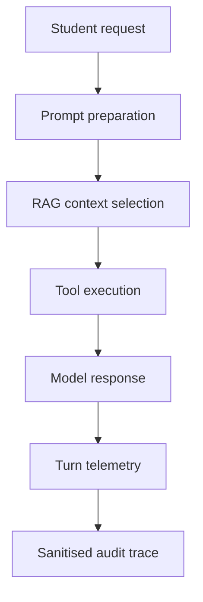

# Observability and Telemetry Evidence

## 1. Purpose

This document explains how the University Student-Support Case Agent records execution telemetry and audit traces. The observability system allows authorised staff to inspect how the agent processed a request without storing unnecessary raw student information.

The implementation is located in:

- `src/telemetry/tracker.py`
- `src/agent/orchestrator.py`

## 2. Information Captured

For every completed agent turn, the telemetry system records:

| Information | Purpose |
|---|---|
| Session identifier | Connects related execution records |
| Turn number | Shows the position of the request in a conversation |
| Model name | Identifies the foundation model used |
| Input tokens | Measures prompt and context usage |
| Output tokens | Measures generated-response usage |
| Total tokens | Supports cost and context-window monitoring |
| Context utilisation | Detects possible context-window overflow |
| Model latency | Measures model response time |
| Tool latency | Measures time spent executing tools |
| Total latency | Measures complete turn duration |
| Tools invoked | Shows which deterministic tools were used |
| Execution status | Records success, recovery or escalation |
| Timestamp | Supports chronological investigation |

The system also creates structured spans for:

- prompt preparation;
- RAG context selection;
- document retrieval;
- deterministic tool execution; and
- model response generation.

## 3. Trace Flow



Each trace contains ordered spans. This allows authorised reviewers to reconstruct the agent’s execution path and identify which stage produced an error or unexpected result.

## 4. Span Structure

Each span contains:

| Field | Meaning |
|---|---|
| `span_id` | Unique position within the trace |
| `span_type` | Prompt, retrieval context, retrieval, tool or model |
| `name` | Human-readable operation name |
| `status` | Outcome of the operation |
| `latency_ms` | Execution duration |
| `attributes` | Sanitised operation-specific evidence |

### 4.1 Prompt Span

The prompt span stores:

- SHA-256 hash of the system prompt template;
- SHA-256 hash of the user query; and
- query length.

The raw prompt and student query are not stored in the trace.

The prompt-template hash allows staff to determine whether two executions used the same prompt version without exposing the prompt contents in operational logs.

### 4.2 RAG Context Span

The RAG context span stores:

- number of selected passages;
- source document;
- citation;
- passage-text SHA-256 hash; and
- passage length.

Raw retrieved passage text is not copied into the audit trace.

### 4.3 Tool Span

Each tool span records:

- tool name;
- sanitised parameters;
- sanitised return payload;
- execution status; and
- latency.

Student identifiers are pseudonymised using SHA-256. Sensitive messages, summaries and responses are represented using hashes and lengths. Secret values such as API keys, passwords and authorisation tokens are redacted.

### 4.4 Model Span

The model span records:

- model name;
- input-token count;
- output-token count;
- total-token count;
- model latency;
- response hash; and
- response length.

The raw model response is not stored in the observability trace.

## 5. Privacy and Security Controls

The telemetry implementation applies the following safeguards:

1. Raw student queries are excluded from turn telemetry.
2. Student identifiers are replaced with pseudonymous hashes.
3. Sensitive text is represented by its SHA-256 hash and character length.
4. API keys, passwords, secrets and authorisation tokens are replaced with `[REDACTED]`.
5. RAG passages are stored as document metadata and text fingerprints rather than raw text.
6. Trace filenames are sanitised to prevent unsafe filesystem paths.
7. Telemetry-writing failures are logged but do not terminate the student-support workflow.
8. Trace access should be restricted to authorised support, engineering and audit staff.

These records are intended for operational investigation and must not be used as a replacement for official student records.

## 6. Storage Locations

The default telemetry locations are:

```text
logs/agent_turn_telemetry.jsonl
traces/<trace-name>.json
```

The JSONL file contains one summary record per agent turn. The trace directory contains structured execution traces with individual spans.

Production deployment must apply institutional access controls, retention periods, encryption and deletion procedures to these locations.

## 7. Example Sanitised Trace

```json
{
  "trace_version": "1.0",
  "trace_name": "session-1_run",
  "session_id": "session-1",
  "status": "success",
  "escalation_required": false,
  "iterations": 1,
  "prompt_template_hash": "a41f...93cd",
  "token_usage": {
    "prompt": 120,
    "completion": 30,
    "total": 150
  },
  "latencies_ms": {
    "model": 80.0,
    "tools": 12.5,
    "total": 95.0
  },
  "rag_evidence": [
    {
      "rank": 1,
      "document": "Academic Handbook",
      "citation": "Section 4.2",
      "text_sha256": "79ab...271e",
      "text_length": 52
    }
  ],
  "spans": [
    {
      "span_id": "span-001",
      "span_type": "prompt",
      "name": "prompt.prepare",
      "status": "ok",
      "latency_ms": 0.0
    },
    {
      "span_id": "span-002",
      "span_type": "retrieval_context",
      "name": "rag.context_selected",
      "status": "ok",
      "latency_ms": 0.0
    },
    {
      "span_id": "span-003",
      "span_type": "tool",
      "name": "tool.get_course_schedule",
      "status": "ok",
      "latency_ms": 12.5
    },
    {
      "span_id": "span-004",
      "span_type": "model",
      "name": "model.generate_response",
      "status": "success",
      "latency_ms": 80.0
    }
  ]
}
```

The shortened hashes above are for illustration. The implementation writes complete SHA-256 hashes.

## 8. Staff Inspection Procedure

An authorised staff member investigating an agent interaction should:

1. Identify the relevant session and approximate timestamp.
2. Locate the corresponding entry in `agent_turn_telemetry.jsonl`.
3. Review its status, token consumption, tools invoked and latency values.
4. Open the matching JSON trace in the `traces` directory.
5. Follow the spans in numerical order.
6. Confirm that the expected prompt version was used by comparing its hash.
7. Check which RAG sources and citations were selected.
8. Review sanitised tool parameters, results and execution status.
9. Confirm that token usage remained within the configured context limit.
10. Check whether the run completed successfully, recovered from an error or escalated to human support.

Raw student information should only be checked in the authorised operational system when necessary and permitted. It should not be reconstructed from telemetry hashes.

## 9. Failure Investigation Examples

### Incorrect Policy Answer

Staff can inspect the retrieval-context span to determine which document and citation were supplied to the model. The passage hash can be compared with the approved knowledge source.

### Tool Failure

Staff can inspect the tool span to determine:

- which tool was called;
- whether its parameters passed validation;
- how long it ran;
- whether it returned an error; and
- whether the agent recovered or escalated.

### Slow Response

Staff can compare model, tool and total latency to identify the slow execution stage.

### Excessive Token Usage

Staff can inspect input, output and total tokens together with the context-window utilisation warning.

### Unexpected Prompt Behaviour

Staff can compare the stored prompt-template hash with the hash of the approved system prompt version.

## 10. Verification Evidence

Dedicated automated tests are located at:

```text
tests/telemetry/test_observability_spans.py
```

They verify that:

- required observability spans are produced;
- token and latency evidence is recorded;
- raw student queries and responses are not stored;
- student identifiers and sensitive tool data are sanitised;
- secrets are redacted; and
- unsafe trace filenames are cleaned.

Test command:

```powershell
python -m pytest tests\telemetry\test_observability_spans.py -q
```

Recorded result:

```text
4 passed
```

The complete project test suite should also be executed before merging:

```powershell
python -m pytest -q
```

## 11. Limitations and Production Controls

This implementation provides local prototype observability. Before production deployment, the University must approve:

- role-based access to telemetry;
- log-retention schedules;
- encrypted storage;
- secure log transfer;
- deletion procedures;
- incident-response responsibilities; and
- monitoring and alert thresholds.

The trace system records evidence of agent behaviour, but it does not independently prove that a response was factually correct. Human review and evaluation tests remain necessary.