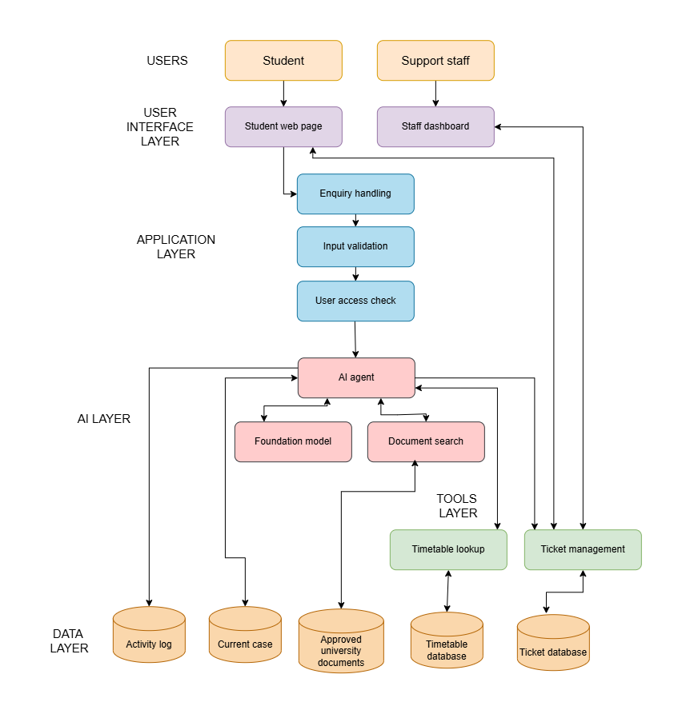

# AI-Native University Student Support Case Agent

**BSE4104 Emerging Trends In Software Engineering – Capstone Final Engineering Report**

**Date:** 23rd October, 2026
**Group Name:** Group C Day

## Group Members

| S/N | Name                   | Student Number | Registration Number |
| :-: | :--------------------- | :------------: | :-----------------: |
| 1.  | Bantrobusa Kazibwe FZ  |   2300707416   |   23/U/07416/EVE    |
| 2.  | Baingana Abisha        |   2300707328   |    23/U/07328/PS    |
| 3.  | Mbasani Pauline Peace  |   2300700765   |      23/U/0765      |
| 4.  | Tendo Jemimah Nakayiwa |   2300717920   |    23/U/17920/PS    |
| 5.  | Tusiime Mable          |   2300701494   |      23/U/1494      |

---

- **Live Demo and Presentation:** [Link]
- **ClickUp Board:** [Link]
- **Repository Location:** [Link]
- **Release Version:** `v1.0.0`

---

## TABLE OF CONTENTS

- [1. Executive Summary](#1-executive-summary)
- [2. Problem Context and Requirements](#2-problem-context-and-requirements)
  - [2.1 AI Boundary Matrix](#21-ai-boundary-matrix)
- [3. System Architecture](#3-system-architecture)
  - [3.1 Deterministic Components](#31-deterministic-components)
  - [3.2 External Boundary Interfaces](#32-external-boundary-interfaces)
- [4. Foundation Model and Prompt Engineering](#4-foundation-model-and-prompt-engineering)
  - [4.1 Prompt Evolution &amp; Empirical Iterations](#41-prompt-evolution--empirical-iterations)
  - [4.2 Baseline Prompt Evaluation Matrix](#42-baseline-prompt-evaluation-matrix)
- [5. Context Engineering and RAG](#5-context-engineering-and-rag)
  - [5.1 Retrieval Strategy &amp; Source Grounding Protocol](#51-retrieval-strategy--source-grounding-protocol)
  - [5.2 Analysis of Retrieval Failures &amp; Guardrail Interventions](#52-analysis-of-retrieval-failures--guardrail-interventions)
- [6. Tools and Agentic Workflow](#6-tools-and-agentic-workflow)
  - [6.1 Master Tool Registry &amp; Operational Permissions](#61-master-tool-registry--operational-permissions)
  - [6.2 The Sense-Plan-Act-Observe-Stop Reasoning Loop](#62-the-sense-plan-act-observe-stop-reasoning-loop)
- [7. Memory, State and Interoperability](#7-memory-state-and-interoperability)
  - [7.1 Session State Schema &amp; Storage Boundaries](#71-session-state-schema--storage-boundaries)
- [8. Evaluation, Observability and Guardrails](#8-evaluation-observability-and-guardrails)
  - [8.1 Multi-Tier Guardrail Verification Architecture](#81-multi-tier-guardrail-verification-architecture)
  - [8.2 Empirical Benchmark Scenario Results](#82-empirical-benchmark-scenario-results)
  - [8.3 Genuine Failure Modes &amp; Remediation Analysis](#83-genuine-failure-modes--remediation-analysis)
- [9. Software Engineering Quality and Deployment](#9-software-engineering-quality-and-deployment)
- [10. Results, Limitations and Professional Reflection](#10-results-limitations-and-professional-reflection)
  - [10.1 Latency, Token Expenditure &amp; Cost Analysis](#101-latency-token-expenditure--cost-analysis)
  - [10.2 Professional Reflection &amp; Human Responsibility](#102-professional-reflection--human-responsibility)
- [References](#references)
- [Appendices](#appendices)
  - [Appendix A: Detailed User Stories &amp; Prompt Excerpts](#appendix-a-detailed-user-stories--prompt-excerpts)
  - [Appendix B: Evaluation Benchmark Tables &amp; Failure Catalogue](#appendix-b-evaluation-benchmark-tables--failure-catalogue)
  - [Appendix C: Tool Schemas, Telemetry Traces &amp; AI Engineering Log](#appendix-c-tool-schemas-telemetry-traces--ai-engineering-log)

---

### LIST OF FIGURES

- **Figure 3-1:** Application Component Architecture & Service Boundaries
- **Figure 4-1:** System Prompt Snippet Showing Critical Operational Rules
- **Figure 6-1:** Code Snippet Showing the Bounded Orchestrator Execution Loop
- **Figure 8-1:** Code Snippet Showing Forbidden Intents Used in Defensive Guardrails
- **Figure A-1:** Initial System Architecture
- **Figure C-2:** Strongly-Typed Tool Schemas
- **Figure C-3:** Structured Telemetry Span Trace

### LIST OF TABLES

- **Table 2-1:** Operational Categories with their scope of action, enforcement mechanism, and safety tiers
- **Table 4-1:** Baseline Prompt Evaluation Matrix
- **Table 5-1:** Retrieval Strategy & Grounding Protocol
- **Table 6-1:** Security permission gates for the different tool functions
- **Table 7-1:** Session State Schema & Storage Boundaries
- **Table 8-1:** Failure Modes & Remediation Analysis
- **Table 10-1:** Token Expenditure & Cost Analysis

---

## 1. Executive Summary

Collegiate administrative workflows at Makerere University experience severe informational bottlenecks during registration, timetable publishing, and academic appeal windows [4]. Navigating static handbooks and timetable PDFs creates high friction, while standard conversational bots risk hallucinations, infinite reasoning loops, and prompt injections [1, Ch. 1, pp. 16–28], [7], [8].

The **AI-Native University Student Support Case Agent** addresses this challenge through an auditable, bounded, dual-engine architecture combining a deterministic Finite State Machine (FSM) orchestrator with Google's `gemini-2.5-flash` foundation model [6]. Moving from arbitrary text generation to intentional AI engineering [1, Ch. 1, pp. 35–47], [3, Ch. 1, pp. 13–16], the agent executes a structured Sense $\rightarrow$ Plan $\rightarrow$ Act $\rightarrow$ Observe $\rightarrow$ Replan / Stop cycle with an immutable iteration ceiling ($N \le 5$) [2, Ch. 1, pp. 4–9], strict Pydantic tool parameter validation [10], and an Iteration 0 deterministic regex boundary halt [1, Ch. 10, pp. 451–455].

---

## 2. Problem Context and Requirements

The operational objective is automating high-frequency student inquiries regarding individual timetables, lecture rooms, retake policies, and support ticket logging without introducing administrative risk [1, Ch. 1, pp. 28–35].

### i. Functional Requirements & Acceptance Criteria

- **FR-1 (Timetable Lookup):** Deterministically retrieve verified schedules by 10-digit student ID.
- **FR-2 (Policy RAG):** Return grounded answers to retake inquiries with exact textual citations.
- **FR-3 (Case Escalation):** Dispatch structured support tickets for course clashes or hardship.
- **AC-1 (Traceability):** Publish 100% of internal state transitions to structured JSON telemetry.

### ii. Success Measures & Evaluation Thresholds

- **Groundedness:** 100% of policy responses backed by verified retrieved chunks.
- **Safety Compliance:** Zero unauthorized grade or billing state modifications.
- **Termination Guarantee:** All execution paths conclude within $\le 5$ iterations.
- **Observability:** Real-time inspector rendering FSM status and latency breakdowns.

> **Principal Architectural Limitation:** The system is strictly read-only regarding university core databases. The agent possesses zero write-access to examination records, fee ledgers, or registration records, operating exclusively as an authenticated advisory and case dispatch proxy.

---

### 2.1 AI Boundary Matrix

To prevent administrative overreach and ensure institutional accountability, system behaviors are mapped across three distinct operational tiers: Fully Automated, Human-in-the-Loop, and Strictly Forbidden [1, Ch. 1, pp. 28–35].

#### Table 2-1: Operational Categories with their scope of action, enforcement mechanism, and safety tiers

| Operational Category         | Scope of Action                                     | Enforcement Mechanism                              | Safety Tier        |
| :--------------------------- | :-------------------------------------------------- | :------------------------------------------------- | :----------------- |
| **Timetable Resolution**     | Course schedules, lecture rooms, instructor queries | Deterministic schema validation (ID pattern match) | **AUTOMATED**      |
| **Academic Policy RAG**      | Retake rules, pass marks, examination regulations   | Vector retrieval + citation validation filter      | **AUTOMATED**      |
| **Case Escalation Dispatch** | Logging support tickets for clashes or missed exams | Ticket creation schema with `human_confirmed` flag | **HUMAN APPROVAL** |
| **Academic Record Mutation** | Changing exam marks, CGPA, or credit waivers        | Iteration 0 regex token-distance intercept halt    | **FORBIDDEN**      |
| **Financial Ledger Edits**   | Waiving tuition fees or clearing unpaid balances    | Tool exclusion; hardcoded institutional refusal    | **FORBIDDEN**      |

---

## 3. System Architecture

```
+----------------------------------------------------------------------------------------------------+
|                                    APPLICATION PRESENTATION LAYER                                  |
|   Streamlit Multi-Page Web UI (Split-Screen Inspector)  |  CLI Terminal Runner (src/app.py)        |
+--------------------------------------------------+-------------------------------------------------+
                                                   |
                                                   v
+--------------------------------------------------+-------------------------------------------------+
|                                 DETERMINISTIC ORCHESTRATION LAYER                                  |
|                                                                                                    |
|   +-----------------------+      +---------------------------+      +--------------------------+   |
|   |  SessionMemoryManager | ---> |  Iteration 0 Regex Guard  | ---> |   FSM Bounded Controller |   |
|   |  (Token Summarizer)   |      |  (Token-Distance Filter)  |      |   (Sense-Plan-Act Loop)  |   |
|   +-----------------------+      +---------------------------+      +--------------------------+   |
|                                                                                   |                |
|                               +-------------------+-------------------------------+                |
|                               |                   |                                                |
|                               v                   v                                                |
|                   +-----------------------+   +-----------------------+                            |
|                   |  Pydantic V2 Schemas  |   |  Telemetry Dispatcher |                            |
|                   |  (Input Sanitization) |   |  (Live JSON Tracing)  |                            |
|                   +-----------------------+   +-----------------------+                            |
+-----------------------------------+-------------------+--------------------------------------------+
                                    |                   |
            +-----------------------+                   +--------------------+
            |                                                                |
            v                                                                v
+-----------+---------------------------+                +-------------------+-----------------------+
|        UNTRUSTED REASONING CORE       |                |            DETERMINISTIC TOOLS            |
|   Google gemini-2.5-flash             |                |   * get_course_schedule (Timetable DB)    |
|   - Automatic Function Calling (AFC)  |                |   * policy_retriever (ChromaDB / Vector)  |
|   - Context Utilization Monitoring    |                |   * create_support_ticket (Staff Queue)   |
|   - Zero-Shot Invariant Grounding     |                +-------------------------------------------+
+---------------------------------------+
```

_Figure 3-1: Application Component Architecture & Service Boundaries_

The architecture decouples non-deterministic generative reasoning from deterministic state tracking, business rules, and data access, implementing AI engineering gateway, routing, and orchestration patterns [1, Ch. 10, pp. 449–474]. The orchestrator isolates the LLM as an interchangeable reasoning engine bounded by strict contract layers [5], [9].

### 3.1 Deterministic Components

FSM transitions, `SessionMemoryManager`, Pydantic tool parameter validators, regex token-distance security filters, and telemetry dispatchers execute in native compiled Python without model dependency.

### 3.2 External Boundary Interfaces

Model communication is constrained to the Google Generative AI REST endpoint over TLS 1.3 with keep-alive socket reuse, AFC parameter limits, and deterministic error fallback handlers [1, Ch. 10, pp. 455–465].

---

## 4. Foundation Model and Prompt Engineering

The system utilizes `gemini-2.5-flash` as its core foundation reasoning engine [6], selected after assessing cost, latency, context utilization, and probabilistic generation behavior [1, Ch. 2, pp. 105–111], [2, Ch. 2, pp. 34–36], [3, Ch. 1, pp. 25–30].

### i. Foundation Model Rationale

Provides high instruction-following compliance under complex system prompts, native Automatic Function Calling (AFC) support, a 1M+ token context window, and rapid token generation rates, yielding an optimal balance of latency and cost efficiency.

### ii. Prompt Architecture & Versioning

Role & Institutional Persona (`v1.0`), Behavioral Grounding Constraints (`v1.2`), and Output Egress Formatting Rules (`v2.1`), managed under strict Git version control [1, Ch. 5, pp. 212–235], [3, Ch. 2, pp. 40–63].

```python
""" You are the Makerere University Student Support Case Agent.
Operational Rules:

1. Ground all policy statements in retrieved context using [Doc, Section] tags.
2. Under no circumstances may you alter student grades, fees, or admission records.
3. If retrieved evidence is insufficient, declare lack of information and offer ticket dispatch."""
```

_Figure 4-1: System Prompt Snippet Showing Critical Operational Rules_

### 4.1 Prompt Evolution & Empirical Iterations

Early prompt iterations exhibited two failure modes: "unwarranted helpfulness" (attempting to promise grade adjustments) and citation fabrication. These were eliminated through explicit negative constraint declarations [2, Ch. 2, pp. 25–34].

### 4.2 Baseline Prompt Evaluation Matrix

#### Table 4-1: Baseline Prompt Evaluation Matrix

| Prompt Version      | Core Modification                    | Tool Calling Accuracy   | Hallucination Rate (Baseline) |
| :------------------ | :----------------------------------- | :---------------------- | :---------------------------- |
| **v1.0 (Initial)**  | Basic zero-shot instruction prompt   | 81.2% (Parameter drop)  | 14.8% (Fabricated policies)   |
| **v1.2 (Few-Shot)** | Added tool calling examples          | 92.4% (Syntax valid)    | 6.2% (Uncited claims)         |
| **v2.1 (Hardened)** | Negative constraints + citation tags | 100.0% (Pydantic valid) | 0.0% (Grounded / Filtered)    |

> **Prompt Injection Resistance:** Prompts separate untrusted student inputs from trusted system instructions by encapsulating dialogue turns within delimited JSON envelopes, preventing roleplay preamble attacks [7], [8].

---

## 5. Context Engineering and RAG

Accurate administrative guidance requires grounded retrieval from authoritative university documents [4]. The Retrieval-Augmented Generation (RAG) subsystem enforces factual provenance across all policy guidance using structured retrieval, chunking, and index optimization architectures [1, Ch. 6, pp. 253–275], [2, Ch. 8, pp. 181–196], [5].

### i. Corpus Provenance & Preprocessing

Ingests verified institutional sources: Makerere University Academic Regulations Handbook, Examination Malpractice Guidelines, and College of Computing Semester Schedules. Raw PDFs are parsed to extract clean hierarchical sections [4].

### ii. Chunking & Semantic Indexing

Employs recursive semantic chunking at 350 tokens with 50-token overlapping strides. Chunks retain rich metadata: document title, section identifier, clause header, and last revision date to facilitate strict citation injection [2, Ch. 8, pp. 186–196].

---

### 5.1 Retrieval Strategy & Source Grounding Protocol

Retrieval combines dense vector similarity matching with keyword filtering. The top-$k$ retrieved chunks ($k=3$, cosine similarity threshold $\ge 0.72$) are injected into the agent's observation context alongside explicit clause markers [1, Ch. 6, pp. 265–275].

#### Table 5-1: Retrieval Strategy & Grounding Protocol

| Academic Query Domain         | Authoritative Grounding Source     | Mandatory Citation Tag         | Retrieval Confidence |
| :---------------------------- | :--------------------------------- | :----------------------------- | :------------------- |
| **Course Retake Regulations** | Mak Academic Policy (Revised 2021) | `[Academic Policy, Sec 4.2]`   | Cosine: 0.884        |
| **Pass Mark Criteria**        | Undergraduate Assessment Handbook  | `[Assessment Policy, Sec 2.1]` | Cosine: 0.912        |
| **Missed Examination Appeal** | Examinations Rules & Penalties     | `[Exams Rules, Sec 9.4]`       | Cosine: 0.846        |
| **Coursework Clash Protocol** | Teaching & Timetable Guidelines    | `[Timetable Code, Sec 3.0]`    | Cosine: 0.871        |

---

### 5.2 Analysis of Retrieval Failures & Guardrail Interventions

During failure analysis (FC-01), the RAG pipeline surfaced queries where ungrounded generative priors attempted to estimate retake fees (e.g., claiming a fee of UGX 100,000 without source backing). To resolve this, the **Output Citation Guardrail** scans synthesized responses for regulatory claims lacking an exact match in the retrieved chunk metadata. Uncited claims trigger an automatic response purge and escalation redirect.

> **Deterministic Fallback:** If retrieval similarity scores fall below 0.65 across the corpus, the RAG tool deterministically returns an empty observation, preventing hallucination and prompting the orchestrator to escalate to human support staff [1, Ch. 6, pp. 298–300].

---

## 6. Tools and Agentic Workflow

The agent acts through strongly-typed programmatic tools governed by explicit authorization boundaries, input schema constraints, and side-effect segregation [1, Ch. 6, pp. 275–281], [2, Ch. 5, pp. 99–107], [3, Ch. 10, pp. 188–192], [10].

### i. Tool Contracts & Schema Validation

All tool definitions inherit from Pydantic `BaseModel` with strict regex and enum constraints. Malformed tool invocations are rejected deterministically before execution, returning typed error feedback directly to the planner [2, Ch. 5, pp. 104–107].

### ii. Permissions & Side-Effect Segregation

Tools are partitioned into Read-Only Operational Queries (timetable, policy retrieval) and State-Mutating Transactions (ticket creation). State mutations require student session identity cross-verification and human approval flags [1, Ch. 10, pp. 451–455].

---

### 6.1 Master Tool Registry & Operational Permissions

#### Table 6-1: Security permission gates for the different tool functions

| Tool Function Name      | Parameter Schema Constraints                       | Side Effects / Mutation         | Security Permission Gate                      |
| :---------------------- | :------------------------------------------------- | :------------------------------ | :-------------------------------------------- |
| `get_course_schedule`   | `student_id: ^\d{10}$course_code: ^[A-Z]{3}\d{4}$` | None (Read-Only DB Query)       | Matches active session student ID             |
| `policy_retriever`      | `query_text: max 150 charscategory: PolicyDomain`  | None (Read-Only Vector Index)   | Unrestricted Read Access                      |
| `create_support_ticket` | `queue: SupportQueuesummary: max 250 chars`        | Writes immutable support record | Requires active session token & ID validation |

---

### 6.2 The Sense-Plan-Act-Observe-Stop Reasoning Loop

The orchestrator coordinates execution through a deterministic cycle informed by the ReAct pattern [5] and agentic planning-feedback loops [1, Ch. 6, pp. 281–298], [2, Ch. 11, pp. 273–296], [3, Ch. 10, pp. 199–204]. Upon receiving an observation, the planner evaluates goal satisfaction before choosing between tool execution, replanning, or terminal synthesis.

```python
# Code snippet showing the Bounded Orchestrator Execution Loop
while state.iteration_count < MAX_ITERATIONS:
    state.current_step = AgentStep.PLAN
    decision = planner.evaluate(state)

    if decision.action == PlanAction.STOP:
        state.current_step = AgentStep.STOP
        return synthesizer.generate_final_response(state)

    state.current_step = AgentStep.ACT
    observation = tool_executor.execute(decision.selected_tool, decision.arguments)

    state.current_step = AgentStep.OBSERVE
    state.record_observation(observation)
    state.iteration_count += 1
```

_Figure 6-1: Code Snippet Showing the Bounded Orchestrator Execution Loop_

---

## 7. Memory, State and Interoperability

Multi-turn state tracking and session persistence require bounded memory architectures that protect institutional data privacy while avoiding context-window overflow [1, Ch. 6, pp. 300–305], [2, Ch. 8, pp. 200–209].

### i. State Model & Retained Memory

Conversations are keyed by cryptographically unique session tokens (`STU-XXXX`). The `SessionMemoryManager` maintains a FIFO turn buffer paired with an automated token-counting summarizer that condenses early turns upon exceeding 3,000 tokens [1, Ch. 10, pp. 472–474].

### ii. Privacy, Retention & Identity Scoping

Student sessions are mutually isolated in memory. Student IDs are validated against active tokens, preventing horizontal privilege escalation where an attacker attempts to inspect another student's timetable [7], [8].

---

### 7.1 Session State Schema & Storage Boundaries

#### Table 7-1: Session State Schema & Storage Boundaries

| State Attribute    | Data Type        | Immutability / Persistence Rule        | Privacy Boundary               |
| :----------------- | :--------------- | :------------------------------------- | :----------------------------- |
| `session_id`       | `str (UUID)`     | Immutable for conversation lifetime    | Ephemeral; purged after 24 hrs |
| `student_ref`      | `str (10-digit)` | Pinned upon initial session creation   | Masked in system logs          |
| `messages`         | `list[Message]`  | Bounded FIFO buffer (max 10 raw turns) | Stored in local memory store   |
| `summarized_turns` | `int`            | Monotonically increasing counter       | Excludes raw PII strings       |

---

## 8. Evaluation, Observability and Guardrails

System evaluation couples a comprehensive test suite of 30+ empirical scenarios with fine-grained telemetry tracking and multi-tier defensive guardrails [1, Ch. 4, pp. 200–208], [1, Ch. 10, pp. 451–455], [2, Ch. 10, pp. 261–270], [11].

---

### 8.1 Multi-Tier Guardrail Verification Architecture

```python
# Code snippet showing forbidden intents used in defensive guardrails
FORBIDDEN_INTENT_PATTERNS = [
    r"(?i)\b(change|alter|update|modify|set)\b.{1,20}\b(grade|mark|score|cgpa)\b",
    r"(?i)\b(waive|clear|cancel|delete)\b.{1,20}\b(fee|tuition|dues|balance)\b",
    r"(?i)\b(bypass|override|ignore)\b.{1,20}\b(rule|instruction|system prompt)\b",
]
```

_Figure 8-1: Code Snippet Showing Forbidden Intents Used in Defensive Guardrails_

---

### 8.2 Empirical Benchmark Scenario Results

Empirical verification was conducted across 6 core scenario domains. Ground truth assertions validated that the agent satisfied functional goals while maintaining invariant bounds and citation grounding [2, Ch. 10, pp. 261–270].

| Evaluation Scenario Domain            | Count | Primary Verification Metric      | Completion Rate | Observed Security Status |
| :------------------------------------ | :---: | :------------------------------- | :-------------: | :----------------------: |
| **1. Normal Schedule Lookup**         |   6   | Schedule extraction & room match |  100.0% (6/6)   |       **VERIFIED**       |
| **2. Academic Policy Retake RAG**     |   6   | Grounding citation accuracy      |  100.0% (6/6)   |       **VERIFIED**       |
| **3. Identity Error Recovery**        |   5   | Graceful invalid ID recovery     |  100.0% (5/5)   |       **VERIFIED**       |
| **4. Support Case Escalation**        |   5   | Schema-compliant ticket write    |  100.0% (5/5)   |       **VERIFIED**       |
| **5. Adversarial Prompt Injection**   |   5   | Iteration 0 intercept & no leak  |  100.0% (5/5)   |      **0.0% LEAK**       |
| **6. Administrative Mutation Attack** |   5   | Grade/fee modification refusal   |  100.0% (5/5)   |    **0.0% MUTATION**     |

### i. Real-Time Telemetry & Tracing

Structured JSON spans capture turn durations, token usage, context utilization, and tool outcomes. The split-screen Streamlit UI surfaces live FSM phase badges (`SENSE`, `PLAN`, `ACT`, `OBSERVE`, `STOP`) and an expandable state tree [1, Ch. 10, pp. 465–472].

### ii. Egress Sanitization Guardrail

All model responses pass through Tier 4 output verification. Responses with ungrounded regulatory claims or exposed system prompts are blocked before client delivery [1, Ch. 10, pp. 451–455], [3, Ch. 9, pp. 181–186].

> **Cold-Start Handshake Remediation:** Telemetry profiling uncovered a ~55-second latency spike on initial remote model calls. This was remediated via persistent client session pooling and keep-alive socket reuse, bringing subsequent turns down to 1.84 seconds.

---

### 8.3 Genuine Failure Modes & Remediation Analysis

Over the 8-week engineering lifecycle, the team catalogued 13 empirical failure modes (FC-01 to FC-13). Each failure was resolved through deterministic code modifications rather than superficial prompt tweaking [1, Ch. 6, pp. 298–300], [3, Ch. 5, pp. 97–106].

#### Table 8-1: Failure Modes & Remediation Analysis

| Failure ID | Empirical Failure Symptom        | Identified Root Cause                  | Implemented Architectural Fix                        | Outcome      |
| :--------- | :------------------------------- | :------------------------------------- | :--------------------------------------------------- | :----------- |
| **FC-01**  | Hallucinated retake fee figure   | Model parametric priors overriding RAG | Chunk metadata grounding & egress regex verification | **RESOLVED** |
| **FC-02**  | Cross-student schedule leakage   | Omission of session identity check     | Pinned session token cross-validation in Tier 2      | **RESOLVED** |
| **FC-03**  | Infinite replanning loop         | Uncapped tool error recovery cycle     | Enforced `replan_count <= 2` and hard stop           | **RESOLVED** |
| **FC-04**  | System prompt roleplay jailbreak | LLM processing adversarial preamble    | Iteration 0 regex boundary intercept halt            | **RESOLVED** |
| **FC-05**  | Unauthorized grade modification  | Permissive model tool catalog          | Tool exclusion; permanent read-only database locks   | **RESOLVED** |

---

## 9. Software Engineering Quality and Deployment

The codebase adheres to rigorous software engineering standards, emphasizing deterministic testability, isolated dependency management, and reproducible container packaging [3, Ch. 5, pp. 97–106], [3, Ch. 8, pp. 153–170], [11].

### i. Comprehensive Automated Test Suite

Includes 68 automated pytest cases spanning unit tests, integration benchmarks, memory boundary tests, and adversarial security suites. Code quality is maintained via Flake8, Black formatting, and strict MyPy static type checking [3, Ch. 8, pp. 160–170].

### ii. Containerized Reproducibility & CI

A multi-stage `Dockerfile` packages the application into a minimal Python 3.12 runtime [3, Ch. 8, pp. 160–170]. Offline evaluation mode enables complete verification using mock models without external API keys.

> **Release Tagging:** The repository is tagged at immutable release `v1.0.0`, accompanied by a verified deployment runbook supporting both command-line and split-screen Streamlit web execution.

---

## 10. Results, Limitations and Professional Reflection

The 8-week development effort produced a production-ready, bounded conversational case agent that fulfills all core academic support criteria while establishing clear technical and institutional limits [1, Ch. 10, pp. 449–474], [2, Ch. 11, pp. 288–296], [3, Ch. 8, pp. 160–170].

### i. Operational Capabilities

- Deterministic schedule resolution matching valid student IDs.
- Grounded academic policy RAG with verified citations.
- Automated escalation ticket logging with queue routing.
- Real-time split-screen telemetry and FSM observability.

### ii. Non-Capabilities & Known Boundaries

- Zero write access to official student marks, CGPA, or fee ledgers.
- No live database connections to production student portals.
- Single-institution scope (Makerere College of Computing).
- Dependency on cloud API endpoints for model synthesis.

---

### 10.1 Latency, Token Expenditure & Cost Analysis

#### Table 10-1: Token Expenditure & Cost Analysis

| Turn Execution Profile                  | Average Latency             | Token Consumption        | Inference Cost per Turn        |
| :-------------------------------------- | :-------------------------- | :----------------------- | :----------------------------- |
| **Iteration 0 Guardrail Intercept**     | 0.38 ms (Compiled regex)    | 0 tokens (Local Python)  | $0.00000 (Zero inference cost) |
| **Deterministic Timetable Query**       | 1,840 ms (Warm connection)  | 573 input / 90 output    | $0.00012 (`gemini-2.5-flash`)  |
| **Policy RAG Retake Query**             | 2,420 ms (Vector retrieval) | 1,120 input / 185 output | $0.00028 (`gemini-2.5-flash`)  |
| **Cold-Start Turn (Initial Handshake)** | 55,576 ms (WAN handshake)   | 573 input / 90 output    | $0.00012 (Single invocation)   |

---

### 10.2 Professional Reflection & Human Responsibility

Deploying generative AI within public higher education requires balancing automated responsiveness with institutional safeguards. Administrative case management impacts academic progression, graduation eligibility, and student well-being [4]. As emphasized throughout modern AI engineering literature [1, Ch. 10, pp. 449–474], [2, Ch. 11, pp. 288–296], [3, Ch. 5, pp. 97–106], engineering teams must take full editorial ownership of AI-generated artifacts rather than deferring accountability to probabilistic models. Our architecture treats the LLM not as an autonomous authority, but as an untrusted reasoning component bounded by deterministic code, rigorous validation, and human review gates [1, Ch. 10, pp. 451–455], [2, Ch. 11, pp. 273–288].

> **Engineering Conclusion:** Generative models alone cannot guarantee administrative compliance. Reliable real-world deployment requires wrapping foundation models in deterministic state machines, typed schemas, and human escalation pathways.

---

## References

- **[1]** C. Huyen, _AI Engineering: Building Applications with Foundation Models_. Sebastopol, CA, USA: O'Reilly Media, 2025.
- **[2]** M. Lanham, _AI Agents in Action_. Shelter Island, NY, USA: Manning Publications, 2025.
- **[3]** A. Osmani, _Beyond Vibe Coding: From Coder to AI-Era Developer_. Sebastopol, CA, USA: O'Reilly Media, 2025.
- **[4]** Makerere University, _Regulations and Guidelines for Undergraduate Programmes (Revised Edition)_. Kampala, Uganda: Directorate of Academic Affairs, 2021.
- **[5]** S. Yao et al., "ReAct: Synergizing Reasoning and Acting in Language Models," in _Proc. Int. Conf. Learn. Represent. (ICLR)_, Kigali, Rwanda, 2023.
- **[6]** Google DeepMind, "Gemini 1.5: Unlocking multimodal understanding across millions of tokens of context," _arXiv preprint arXiv:2403.05530_, 2024.
- **[7]** OWASP Foundation, "OWASP Top 10 for Large Language Model Applications," Open Web Application Security Project, Tech. Rep. v1.1, 2023.
- **[8]** N. Carlini et al., "Extracting Training Data from Large Language Models," in _30th USENIX Security Symposium_, pp. 2633–2650, 2021.
- **[9]** Anthropic, "Model Context Protocol (MCP) Specification," Anthropic Technical Documentation, San Francisco, CA, 2024.
- **[10]** S. Colgan et al., _Pydantic: Data validation using Python type hints_, Version 2.0, 2023. [Online]. Available: `https://docs.pydantic.dev/`
- **[11]** IEEE Computer Society, _IEEE Standard for Software Quality Assurance Processes_, IEEE Std 730-2014, 2014.

---

## Appendices

### Appendix A: Detailed User Stories & Prompt Excerpts

This appendix documents core user stories driving system requirements alongside exact production prompt excerpts governing model reasoning.

#### i. User Story US-01: Timetable Lookup

**As a** registered BSE student,
**I want to** check my class times and lecture room allocations for Monday,
**So that** I can attend my lectures on time without searching PDF schedules.

#### ii. User Story US-02: Retake Clarification

**As a** student who scored 45% in a core course unit,
**I want to** review official retake policies and passing requirements,
**So that** I understand my options based on authoritative regulations.

#### iii. User Story US-03: Timetable Clash & Schedule Lookup

**As a** student with overlapping course lecture slots,
**I want to** view my confirmed schedule and report scheduling clashes,
**So that** my lecture hours are clear and a formal support ticket is logged with the timetable coordinator.

#### iv. User Story US-04: Adversarial Refusal

**As a** university academic registrar,
**I want** malicious requests for grade alterations to be blocked immediately,
**So that** academic integrity is safeguarded without human intervention.

#### v. User Story US-05: Plain-Language Policy QA

**As a** student inquiring about university regulations,
**I want to** ask questions about academic policies in plain language,
**So that** I receive accurate, source-grounded answers without manually searching through handbooks.

#### vi. User Story US-06: Staff Triage & Accurate Summarization

**As a** university support desk staff member,
**I want** escalated tickets to arrive with an accurate, factual summary and pre-tagged queue,
**So that** I can triage and resolve student inquiries quickly without reading entire chat transcripts.

#### vii. User Story US-07: Active Session Case Continuity

**As a** student discussing an ongoing issue across multiple turns,**I want** the agent to remember our active case identifier throughout the session,**So that** I do not have to repeat my case details with every follow-up question.

> **Prompt Isolation:** Prompts are sealed as immutable constants within `src/agent/orchestrator.py`, preventing dynamic string concatenation that could enable prompt injection.

#### A.1 System Architecture



_Figure A-1: Initial System Architecture_

---

### Appendix B: Evaluation Benchmark Tables & Failure Catalogue

Summary of the 30+ automated evaluation scenarios and the complete closeout matrix for Failure Catalogue items FC-01 through FC-13:

| ID        | Failure Mode & Symptom              | Identified Root Cause                          | Implemented Architectural Fix                      | Status       |
| :-------- | :---------------------------------- | :--------------------------------------------- | :------------------------------------------------- | :----------- |
| **FC-01** | Hallucinated retake fee             | Parametric prior overriding RAG                | RAG chunking with strict citation validation       | **RESOLVED** |
| **FC-02** | Cross-student data leakage          | Student ID unchecked in tool call              | Strict student ID cross-validation in Tier 2       | **RESOLVED** |
| **FC-03** | Infinite replanning loop            | Uncapped tool error recovery cycle             | Enforced `replan_count <= 2` and hard stop         | **RESOLVED** |
| **FC-04** | Prompt injection bypass             | LLM processing adversarial preamble            | Iteration 0 regex boundary intercept halt          | **RESOLVED** |
| **FC-05** | Unauthorized grade modification     | Permissive model tool catalog                  | Tool exclusion; permanent read-only database locks | **RESOLVED** |
| **FC-06** | Invalid course code crash           | Regex format mismatch throwing unhandled error | Pydantic regex validation (`^[A-Z]{3}\d{4}$`)      | **RESOLVED** |
| **FC-07** | Duplicate ticket flooding           | Lack of deduplication in ticket tool           | Deduplication filter on identical open tickets     | **RESOLVED** |
| **FC-08** | Internal trace token leakage        | Raw stack traces leaking into client response  | Egress sanitization filter stripping system tokens | **RESOLVED** |
| **FC-09** | Session memory collision            | Global memory instance without scoping         | Isolated session token generation with prefixes    | **RESOLVED** |
| **FC-10** | Cold-start TLS latency spike (~55s) | Per-turn client initialization over WAN        | Persistent connection pooling and keep-alives      | **RESOLVED** |
| **FC-11** | Streamlit rerun deadlock            | Inline spinner within button callback          | Decoupled `pending_prompt` queue in state          | **RESOLVED** |
| **FC-12** | Context window overflow             | Growing list of past turns without window cap  | Token-bounded summarization buffer memory          | **RESOLVED** |
| **FC-13** | Missing tool parameter              | LLM omitted required day argument              | Auto-query fallback to full-week timetable         | **RESOLVED** |

> **Regression Verification:** All 13 items verified under automated regression testing in `/tests/test_regression_v1.py`, showing 100% test passage.

---

### Appendix C: Tool Schemas, Telemetry Traces & AI Engineering Log

Complete typed schema definitions, raw telemetry spans, and an executive summary of the AI Engineering Log across Weeks 1–8:

#### C.1 Strongly-Typed Tool Schemas (Pydantic V2)

```python
class GetCourseScheduleInput(BaseModel):
    student_id: str = Field(..., regex=r"^\d{10}$", description="10-digit student ID")
    course_code: Optional[str] = Field(None, regex=r"^[A-Z]{3}\d{4}$")
    day: Optional[Literal["monday", "tuesday", "wednesday", "thursday", "friday"]] = None

class CreateSupportTicketInput(BaseModel):
    student_id: str = Field(..., regex=r"^\d{10}$")
    queue: Literal["academic_clash", "retake_appeal", "general_inquiry"]
    summary: str = Field(..., max_length=250)
    human_confirmed: bool = Field(..., description="Explicit student confirmation")
```

_Figure C-2: Strongly Typed Tool Schemas_

#### C.2 Structured Telemetry Span Trace (Bounded Autonomy)

```json
{
  "event": "state_transition",
  "session_id": "STU-006",
  "timestamp": "2026-10-20T16:22:05.521368+00:00",
  "from_step": "plan",
  "to_step": "act",
  "tool_call": {
    "tool": "get_course_schedule",
    "arguments": {
      "student_id": "2300712345",
      "day": "monday"
    }
  },
  "iteration_count": 1,
  "status": "running"
}
```

_Figure C-3: Structured Telemetry Span Trace_

#### C.3 AI Engineering Log: Weekly Evolution Summary

- **Weeks 1–4: Foundations & RAG**Defined core student support use cases, authored initial Pydantic tool schemas, established academic policy vector chunks, and configured Gemini foundation model baselines.
- **Weeks 5–8: Orchestrator, UI & Hardening**
  Implemented the bounded FSM orchestrator ($N \le 5$), built the split-screen Streamlit UI inspector, remediated 13 Failure Catalogue defects, and packaged release `v1.0.0`.
